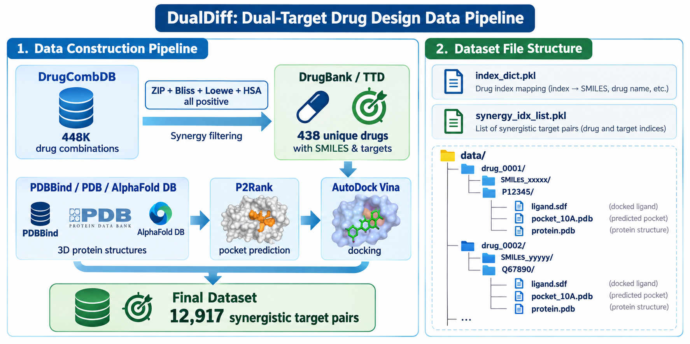
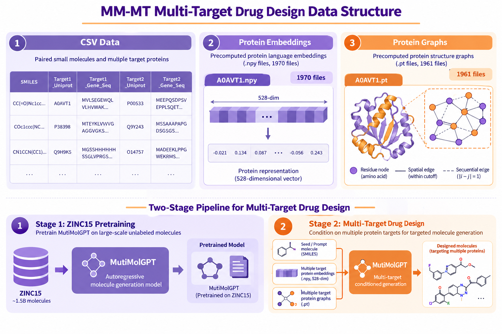
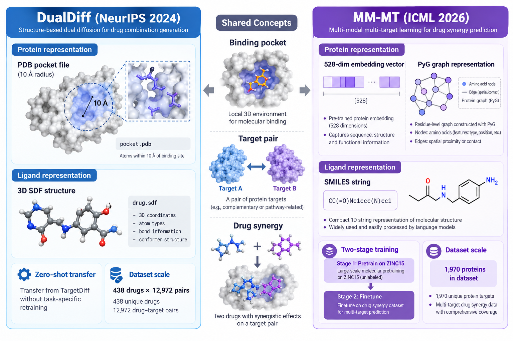

# 多靶点药物设计 — 数据协作指南

> **协作模式**：数据由本地端上传至 [Modal](https://modal.com/) 云端 Volume，清华端从 Volume 拉取数据到服务器使用。
>
> 本仓库所有脚本（`download_*.py`, `inspect_*.py`, `share_data.py`）均为**本地端维护脚本**，清华端无需运行。

---

## 数据总览

两篇论文的数据均已上传至 Modal Volume `drug-design-data`，路径 `/data/repos/`。

| 数据集 | 论文 | 大小 | 状态 |
|--------|------|------|------|
| DualDiff | NeurIPS 2024 | 556 MB（已解压） | ✅ 可直接使用 |
| MM-MT (multidata.zip) | ICML 2026 | 451.6 MB（压缩） | ⚠️ 需解压后使用 |
| TargetDiff | ICLR 2023（DualDiff 依赖） | 代码仓库 | ✅ 已克隆 |

### 数据架构图

```
┌──────────────────────────────────────────────────────────────┐
│  本地端 (macOS)                                              │
│                                                              │
│  download_to_modal.py  ──→  git clone 3 个仓库               │
│  download_hf_data.py   ──→  DualDiff data.tar.gz 下载+解压   │
│  inspect_data_format.py ──→  验证数据格式                     │
│  verify_modal_data.py  ──→  验证完整性                        │
│  share_data.py         ──→  Web 文件列表（可选）              │
│                              │                               │
│                              ▼                               │
│                    Modal Volume: drug-design-data             │
│                    /data/repos/                               │
│                    ├── DualDiff/     (556 MB, 已解压)         │
│                    ├── MM-MT/        (451.6 MB zip)           │
│                    └── targetdiff/   (代码)                   │
│                              │                               │
│                    share_data.py → Web 端点（文件浏览+下载）   │
└──────────────────────────────┼───────────────────────────────┘
                               │ curl / wget（HTTPS 下载）
                               ▼
┌──────────────────────────────────────────────────────────────┐
│  清华端 (Linux 服务器)                                        │
│                                                              │
│  ~/multi-target-drug-design/                                 │
│  ├── DualDiff/data/processed/   ← 直接使用                   │
│  ├── MM-MT/multidata/           ← 解压后使用                  │
│  └── targetdiff/                ← 预训练权重                  │
└──────────────────────────────────────────────────────────────┘
```

---

## 复现就绪状态

| 论文 | 数据集 | 模型权重 | 能跑吗 | 备注 |
|------|--------|---------|--------|------|
| **MM-MT** | ✅ multidata.zip（79,514 行 CSV + 嵌入 + 图） | 不需要外部权重 | **✅ 直接可跑** | 不需要 ZINC15 预训练，数据全在 zip 里 |
| **DualDiff** | ✅ 12,972 对协同靶点 + 438 复合物 | ❌ 需手动下载 TargetDiff checkpoint | **⚠️ 差一步** | 见下方手动下载说明 |

### DualDiff 唯一缺失项：TargetDiff 预训练权重

Google Drive 限制自动化下载，需要**在有浏览器的机器上手动下载**后上传到服务器。

1. 浏览器打开：https://drive.google.com/drive/folders/1-ftaIrTXjWFhw3-0Twkrs5m0yX6CNarz
2. 下载整个文件夹（或里面的 `.pt` 文件）
3. 放到服务器的 `targetdiff/pretrained_models/` 目录下

```bash
# 下载后上传到服务器
scp pretrained_model.pt user@tsinghua-server:~/multi-target-drug-design/targetdiff/pretrained_models/
```

> **MM-MT 不需要预训练**。`multidata.zip` 已包含全部训练所需数据，直接运行 `python model/2MM-MT-surf-drugdesignv10.py` 即可。ZINC15 数据和预训练脚本仅供作者展示数据来源，复现实验不需要。

---

## 清华端：快速开始

### 1. 下载数据

数据通过共享链接下载，无需安装任何工具。部署后的链接格式：

```
https://iabtcun--drug-design-share-download-repo.us-east.modal.run?repo=DualDiff    # 整个 DualDiff 仓库 (tar.gz)
https://iabtcun--drug-design-share-download-repo.us-east.modal.run?repo=MM-MT       # 整个 MM-MT 仓库 (tar.gz)
https://iabtcun--drug-design-share-download-repo.us-east.modal.run?repo=targetdiff  # TargetDiff 仓库 (tar.gz)
```

> **数据浏览页**：https://iabtcun--drug-design-share-list.us-east.modal.run （可在浏览器中查看所有文件，点击直接下载）

```bash
# 在服务器上执行
mkdir -p ~/multi-target-drug-design && cd ~/multi-target-drug-design

# 下载并解压（三选一或全部）
curl -L "https://iabtcun--drug-design-share-download-repo.us-east.modal.run?repo=DualDiff" | tar xz
curl -L "https://iabtcun--drug-design-share-download-repo.us-east.modal.run?repo=MM-MT" | tar xz
curl -L "https://iabtcun--drug-design-share-download-repo.us-east.modal.run?repo=targetdiff" | tar xz
```

也可以只下载单个文件：
```bash
# 下载特定文件
curl -LO "https://iabtcun--drug-design-share-download.us-east.modal.run?path=DualDiff/data/processed/dock/index_dict.pkl"
```

### 2. 解压 MM-MT 数据

```bash
cd ~/multi-target-drug-design/MM-MT
unzip data/multidata.zip
# 解压后得到 multidata/ 目录，约 1.5 GB
```

### 4. 验证数据完整性

```python
# 快速验证脚本，保存为 verify.py 运行
import pickle, os

# ---- DualDiff ----
dd = "DualDiff/data/processed"

with open(f"{dd}/dock/index_dict.pkl", "rb") as f:
    index_dict = pickle.load(f)
with open(f"{dd}/drug_synergy/synergy_idx_list.pkl", "rb") as f:
    synergy_list = pickle.load(f)

assert "smiles_to_idx" in index_dict and "idx_to_smiles" in index_dict
assert len(index_dict["idx_to_smiles"]) == 438, f"Expected 438, got {len(index_dict['idx_to_smiles'])}"
assert len(synergy_list) == 12972, f"Expected 12972, got {len(synergy_list)}"

dataset_dir = f"{dd}/dock/ligand_protein_dataset_v2"
drugs = [d for d in os.listdir(dataset_dir) if os.path.isdir(os.path.join(dataset_dir, d))]
assert len(drugs) == 438, f"Expected 438 drug dirs, got {len(drugs)}"

print(f"✅ DualDiff: {len(drugs)} 药物, {len(synergy_list)} 协同对")

# ---- MM-MT ----
import pandas as pd
df = pd.read_csv("MM-MT/multidata/filtered_dual_target_data2.csv")
npy_count = len([f for f in os.listdir("MM-MT/multidata/prot_emb_data") if f.endswith(".npy")])
pt_count = len([f for f in os.listdir("MM-MT/multidata/prot_graph_data") if f.endswith(".pt")])

print(f"✅ MM-MT: {len(df)} 行 CSV, {npy_count} 蛋白嵌入, {pt_count} 蛋白图")
```

---

## 一、DualDiff（NeurIPS 2024）

### 数据总览

| 项目 | 值 |
|------|-----|
| **总大小** | 556 MB（解压后） |
| **药物数** | 438 |
| **协同靶点对数** | 12,972 条（含双向对；6,486 个唯一无序对） |
| **论文声称对数** | 12,917（见下方说明） |
| **数据来源** | DrugCombDB → DrugBank/TTD → PDBBind/PDB/AlphaFold DB |
| **HF 地址** | https://huggingface.co/datasets/zhouxiangxin/DualDiff |
| **GitHub** | https://github.com/zhouxiangxin1998/DualDiff |



#### ⚠️ 论文数字 vs 实际数据：12,917 vs 12,972

DualDiff 论文（v1/v2）和后续引用者 FuseDiff（arXiv:2603.05567, 2026）均报告 **12,917** 对，但开源 `synergy_idx_list.pkl` 实际包含 **12,972** 条（差 55 条，0.42%）。

**验证结果**（Modal 远程运行 `verify_data_counts.py`）：
- pkl 总条目：12,972；唯一无序对：6,486；双向存在的：12,960（12 条仅有单向）
- 论文 v1→v2 文本未更新此数字，代码中无任何过滤到 12,917 的逻辑
- FuseDiff 直接复用了论文数字，未独立验证 pkl

**对实验的影响**：基本无影响。55/12,972 = 0.42%，对 mean/median 聚合指标（Vina Dock、QED、SA）的扰动可忽略。所有方法在同一 pkl 上评估，baseline 对比公平性不受影响。论文中可直接使用 12,972 全集，如审稿人追问可在 appendix 说明此差异。

### 目录结构

```
DualDiff/data/processed/
├── dock/
│   ├── index_dict.pkl                    # 药物索引映射（438 条）
│   └── ligand_protein_dataset_v2/        # 438 个药物-靶点复合物
│       └── {SMILES}/{UniProt_ID}/
│           ├── ligand.sdf                # 参考配体 3D 结构
│           ├── pocket_10A.pdb            # 结合口袋（配体 10Å 内残基）
│           ├── protein.pdb              # 完整蛋白
│           └── protein_clean.pdb        # 清洗后蛋白
└── drug_synergy/
    └── synergy_idx_list.pkl              # 协同靶点对列表
```

### 文件格式详解

#### `index_dict.pkl` — 药物索引映射

```python
import pickle

with open("DualDiff/data/processed/dock/index_dict.pkl", "rb") as f:
    index_dict = pickle.load(f)

# 结构: dict, 2 个 key
# index_dict["smiles_to_idx"] → {SMILES_str: int}  438 条
# index_dict["idx_to_smiles"] → {int: SMILES_str}  438 条

smiles_to_idx = index_dict["smiles_to_idx"]
idx_to_smiles = index_dict["idx_to_smiles"]

print(idx_to_smiles[0])   # "C#CC1(O)C=CC2C3CCC4=CC(=O)CCC4C3CCC21CC"
print(smiles_to_idx["C1CNCCN1"])  # 9
```

#### `synergy_idx_list.pkl` — 协同靶点对

```python
with open("DualDiff/data/processed/drug_synergy/synergy_idx_list.pkl", "rb") as f:
    synergy_list = pickle.load(f)

# list of tuple(int, int), 共 12,972 条
# 包含双向对: (a,b) 和 (b,a) 都在列表中
print(len(synergy_list))       # 12972
print(synergy_list[0])         # (0, 36)

# 去重获取唯一对
unique_pairs = set(tuple(sorted(p)) for p in synergy_list)
print(len(unique_pairs))       # 6486
```

#### 复合物文件

```python
from rdkit import Chem

# 配体 (ligand.sdf) — 参考配体的 3D 构象
mol = Chem.MolFromMolFile("DualDiff/data/processed/dock/ligand_protein_dataset_v2/"
                          "C%23CC1(O)C%3DCC2C3CCC4%3DCC(%3DO)CCC4C3CCC21CC/"
                          "P06401/ligand.sdf")
print(mol.GetNumAtoms())    # 23

# 口袋 (pocket_10A.pdb) — 配体 10Å 范围内的蛋白残基，用于 SBDD 输入
# 完整蛋白 (protein_clean.pdb) — 去掉了水分子和杂原子
```

### 完整使用流程

```python
"""DualDiff 数据加载 → 双靶点药物设计"""
import pickle, os
from rdkit import Chem

DATA_ROOT = "DualDiff/data/processed"

# Step 1: 加载索引
with open(f"{DATA_ROOT}/dock/index_dict.pkl", "rb") as f:
    index_dict = pickle.load(f)
with open(f"{DATA_ROOT}/drug_synergy/synergy_idx_list.pkl", "rb") as f:
    synergy_list = pickle.load(f)

idx_to_smiles = index_dict["idx_to_smiles"]
print(f"药物数: {len(idx_to_smiles)}, 协同对数: {len(synergy_list)}")

# Step 2: 选一对协同靶点
pair = synergy_list[0]  # (0, 36)
drug1_smiles = idx_to_smiles[pair[0]]
drug2_smiles = idx_to_smiles[pair[1]]

# Step 3: 加载复合物结构
DATASET_DIR = f"{DATA_ROOT}/dock/ligand_protein_dataset_v2"

def load_complex(smiles):
    drug_dir = os.path.join(DATASET_DIR, smiles)
    for uniprot_id in os.listdir(drug_dir):
        t_dir = os.path.join(drug_dir, uniprot_id)
        return {
            "uniprot_id": uniprot_id,
            "ligand": Chem.MolFromMolFile(f"{t_dir}/ligand.sdf"),
            "pocket_pdb": f"{t_dir}/pocket_10A.pdb",
            "protein_pdb": f"{t_dir}/protein_clean.pdb",
        }

complex1 = load_complex(drug1_smiles)
complex2 = load_complex(drug2_smiles)
print(f"Target 1: {complex1['uniprot_id']}, atoms: {complex1['ligand'].GetNumAtoms()}")
print(f"Target 2: {complex2['uniprot_id']}, atoms: {complex2['ligand'].GetNumAtoms()}")

# Step 4: 口袋对齐 → python dual_scripts/align/align_protein_ligand_score.py
# Step 5: 双靶点采样 → bash dual_scripts/example/sample_dualdiff.sh
# Step 6: 评估 → python dual_scripts/evaluate/evaluate_compose.py
```

### TargetDiff 预训练模型

DualDiff 是零样本方法，直接用 TargetDiff 预训练权重，不需要训练：

```bash
# 预训练模型在 targetdiff/ 仓库，按其 README 下载权重即可
# CrossDocked2020 数据仅在需要重新训练时才需要
```

---

## 二、MM-MT（ICML 2026）

### 数据总览

| 项目 | 值 |
|------|-----|
| **multidata.zip** | 451.6 MB（压缩），~1.5 GB（解压） |
| **核心 CSV** | `filtered_dual_target_data2.csv`（79,514 行） |
| **蛋白嵌入** | 1,970 个 `.npy` 文件（1024 维） |
| **蛋白图数据** | 1,961 个 `.pt` 文件（PyG Data） |
| **CSV 中唯一靶点** | 1,057 个 UniProt ID |
| **GitHub** | https://github.com/HaoranLiu1998/MM-MT |



> **注意**: `.npy` 和 `.pt` 文件的 UniProt ID **完全不重叠**，它们代表两组不同蛋白的不同模态表示。

### 目录结构（解压后）

```
MM-MT/
├── multidata/
│   ├── filtered_dual_target_data2.csv       # 主数据（SMILES + 双靶点）
│   ├── prot_emb_data/                       # 蛋白嵌入（1,970 × .npy）
│   │   ├── A0AVT1.npy                       # shape (1, 1024), float32
│   │   └── ...
│   └── prot_graph_data/                     # 蛋白结构图（1,961 × .pt）
│       ├── P00533.pt                        # PyG Data 对象
│       └── ...
├── model/
│   ├── 1pretrainedmodelv1-MutiMolGPT.py     # 预训练模型
│   └── 2MM-MT-surf-drugdesignv10.py         # 主模型
├── data/                                    # 数据处理脚本
│   ├── 1screenpretraindatafromZINC15.py
│   ├── 2pretrainedsmiles_properties.py
│   ├── 3PDB2graph.py
│   └── 4screenmultimodaldata.py
└── result/                                  # 实验结果（MEK1, mTOR）
```

### 文件格式详解

#### CSV 主数据

```python
import pandas as pd

df = pd.read_csv("MM-MT/multidata/filtered_dual_target_data2.csv")
print(df.shape)           # (79514, 5)
print(df.columns.tolist())
# ['SMILES', 'Target1_Uniprot', 'Target1_Encoded_Gene_Seq',
#  'Target2_Uniprot', 'Target2_Encoded_Gene_Seq']
```

#### 蛋白嵌入 `.npy`

```python
import numpy as np

emb = np.load("MM-MT/multidata/prot_emb_data/A0AVT1.npy")
print(emb.shape)    # (1, 1024)
print(emb.dtype)    # float32
```

#### 蛋白图 `.pt`

```python
import torch

graph = torch.load("MM-MT/multidata/prot_graph_data/P00533.pt")
# PyG Data: graph.x (节点特征), graph.edge_index (边), graph.pos (3D 坐标)
```

### 完整使用流程

```python
"""MM-MT 数据加载 → 多靶点药物设计"""
import pandas as pd, numpy as np, torch

# Step 1: 加载主数据表
df = pd.read_csv("MM-MT/multidata/filtered_dual_target_data2.csv")
print(f"数据量: {len(df)}, 药物数: {df['SMILES'].nunique()}")

# Step 2: 选一条数据
row = df.iloc[0]
target1, target2 = row["Target1_Uniprot"], row["Target2_Uniprot"]

# Step 3: 加载蛋白表示
emb1 = np.load(f"MM-MT/multidata/prot_emb_data/{target1}.npy")
graph1 = torch.load(f"MM-MT/multidata/prot_graph_data/{target1}.pt")

# Step 4: 运行模型
# 预训练: python model/1pretrainedmodelv1-MutiMolGPT.py
# 多靶点设计: python model/2MM-MT-surf-drugdesignv10.py
```

### 环境配置

```bash
conda create -n polypharma python=3.11.9
conda activate polypharma
conda install -c rdkit rdkit
pip install torch torchvision torchaudio
conda env create -f environment.yml
# 额外依赖: torch_geometric, torch_scatter, biopython, scipy, kan, numpy, tqdm
```

---

## 二-B、MM-MT 数据完整性分析（论文 vs 仓库）

> **结论：79,514 行 CSV 就是最终训练数据，论文写的 75,921 与实际仓库不一致。**

### README 原文

> **"## 2. Multi-Target Training Dataset"**
> "The processed multi-target dataset is **provided in**: `./data/multidata/filtered_dual_target_data2.csv`"

README 明确说 CSV 就是最终提供的训练数据，不是中间产物。

### 4 个预处理脚本的用途

| 脚本 | 用途 | 用于哪个阶段 |
|------|------|-------------|
| 脚本 1 `screenpretraindatafromZINC15.py` | 从 ZINC15 筛选分子 | **预训练**（8000 万分子） |
| 脚本 2 `pretrainedsmiles_properties.py` | 计算 8 维属性 | **预训练** |
| 脚本 3 `3PDB2graph.py` | PDB → 结构图 (.pt) | 生成 `stru_data/` |
| 脚本 4 `4screenmultimodaldata.py` | 拼装多模态训练 batch | 从 CSV + 蛋白文件 → 训练用 .pkl |

- **脚本 1、2 是预训练用的（ZINC15），跟多靶点训练数据无关**
- 脚本 3 的输出 `stru_data/` 已在 zip 中提供
- 脚本 4 的输入 `smi_prot.xlsx`（未开源），其输出就是 CSV

### 模型代码如何使用数据

```python
dataset = MultiModalDualTargetDataset(
    csv_file="../data/multidata/filtered_dual_target_data2.csv",  # 直接读全部行
    prot_emb_dir="../data/multidata/prot_emb_data",
    prot_struct_dir="../data/multidata/stru_data",
    mol_prop_file="../data/multidata/filtered_dual_mol_8properties.txt"
)
```

**没有任何过滤**。读 CSV 全部行，加载对应 `.npy` 和 `.pt`，直接训练。

### 论文 vs 仓库对比

| | 论文 Appendix C | 实际仓库 |
|--|----------------|---------|
| 最终数据 | 75,921 行, 1,305 蛋白 | **79,514 行, 1,057 蛋白**（CSV 全量） |
| 来源 | 90,432 → 经 4 步过滤 | CSV 标注为 "processed"，模型直接使用 |
| 过滤脚本 | 描述了 SMILES/靶点/同源性过滤 | **无对应代码开源** |

### 缺失的原始文件

以下文件在脚本中被引用，但 **未包含在 `multidata.zip` 中**：

| 文件 | 引用位置 | 状态 |
|------|---------|------|
| `smi_prot.xlsx` | 脚本 4 输入 | ❌ 未开源 |
| `ID2Refseq.xlsx` | 脚本 4 UniProt→RefSeq 映射 | ❌ 未开源 |
| `gene_seq_data/mRNA_ID.txt` | 脚本 4 核苷酸序列 | ❌ 未开源 |
| `gene_seq_data/mRNA_Seq.txt` | 脚本 4 核苷酸序列 | ❌ 未开源 |
| `vocab.pkl` | 模型脚本 SMILES 词表 | ❌ 未开源 |
| `smiles.txt` | 脚本 1 词典 | ❌ 未开源 |
| `filtered_dual_mol_8properties.txt` | 模型脚本 8 维属性 | ❌ 未开源 |

### 结论

79,514 行 CSV 就是作者实际使用的训练数据。论文中的 75,921 大概率是早期版本的数字（投稿后更新了数据但未修改论文），这在 ML 论文中很常见。可直接使用 79,514 行 CSV 进行训练。

---

## 三、两篇论文数据对比



| 维度 | DualDiff | MM-MT |
|------|----------|-------|
| **蛋白表示** | PDB 口袋文件 (pocket_10A.pdb) | 嵌入 (.npy 1024维) + 图 (.pt) |
| **配体表示** | SDF 3D 结构 (ligand.sdf) | SMILES 字符串 |
| **靶点对来源** | DrugCombDB 协同性筛选 | CSV 中直接给出 |
| **训练方式** | 零样本（TargetDiff 预训练权重） | 两阶段（ZINC15 预训练 + 微调） |
| **数据量** | 438 药物, 6,486 唯一对 | 79,514 行, 1,057 蛋白 |
| **预处理** | 下载即用 | 需运行脚本处理 ZINC15 和 PDB |

---

## 四、Modal Volume 数据管理（仅限本地端）

> 以下内容为数据维护者参考，清华端无需关注。

### Volume 结构

```python
import modal
volume = modal.Volume.from_name("drug-design-data")

# /data/repos/DualDiff/data/processed/   ← 已解压，可直接使用
# /data/repos/MM-MT/data/multidata.zip   ← 451.6 MB，清华端拉取后需解压
# /data/repos/targetdiff/                ← TargetDiff 代码
```

### 本地维护脚本说明

| 脚本 | 功能 | 何时运行 |
|------|------|----------|
| `download_to_modal.py` | git clone 三个仓库到 Volume | 初始化时运行一次 |
| `download_hf_data.py` | 从 HuggingFace 下载 DualDiff 数据并解压 | 初始化时运行一次 |
| `inspect_data_format.py` | 检查 pkl/sdf/pdb/csv/npy/pt 文件格式 | 验证数据完整性 |
| `verify_modal_data.py` | 验证 Volume 中三个仓库的目录结构 | 验证数据完整性 |
| `share_data.py` | 部署 Web 端点，展示文件列表 | 可选，方便浏览 |

### 在 Modal 上直接跑实验（替代拉取到服务器）

```python
@app.function(
    image=your_image,
    volumes={"/data": volume},
    gpu="A10G",
)
def run_dualdiff():
    import os
    os.chdir("/data/repos/DualDiff")
    # 直接使用数据，无需下载

@app.function(
    image=your_image,
    volumes={"/data": volume},
    gpu="A10G",
)
def run_mmmt():
    import os, zipfile
    if not os.path.isdir("/data/repos/MM-MT/multidata"):
        with zipfile.ZipFile("/data/repos/MM-MT/data/multidata.zip") as z:
            z.extractall("/data/repos/MM-MT/")
    os.chdir("/data/repos/MM-MT")
    # 直接使用数据
```

---

## 五、数据下载链接汇总

| 数据 | 链接 | 说明 |
|------|------|------|
| DualDiff 代码 | https://github.com/zhouxiangxin1998/DualDiff | 仓库 |
| DualDiff 数据 | https://huggingface.co/datasets/zhouxiangxin/DualDiff | data.tar.gz |
| MM-MT 代码+数据 | https://github.com/HaoranLiu1998/MM-MT | 含 multidata.zip |
| TargetDiff | https://github.com/guanjq/targetdiff | 预训练模型 |
| CrossDocked2020 | https://bits.csb.pitt.edu/files/crossdock2020/ | 仅重新训练时需要 |
| DrugCombDB | http://drugcombdb.denglab.org/main | DualDiff 数据来源 |
